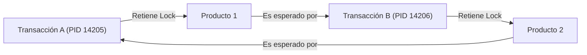

# Informe de Concurrencia y Aislamiento en PostgreSQL 16

**Cátedra:** Base de Datos II  
**Carrera:** Tecnicatura Universitaria en Programación a Distancia (UTN)  
**Proyecto Integrador:** Food Store  
**Autor:** Joaquin Chiarello  
**Entorno de Pruebas:** PostgreSQL 16.x sobre GNU/Linux

---

## 1. Introducción al Modelo MVCC de PostgreSQL

PostgreSQL gestiona la concurrencia a través del mecanismo de Control de Concurrencia Multiversión (MVCC - *Multi-Version Concurrency Control*). A diferencia de los motores basados exclusivamente en bloqueos de lectura que detienen a los escritores, en PostgreSQL los lectores no bloquean a los escritores y los escritores no bloquean a los lectores. 

Cada operación de actualización o borrado preserva la versión física anterior de la tupla en la estructura de almacenamiento (*heap*). El encabezado de cada fila almacena identificadores de transacción:
* `xmin`: El identificador de transacción (`XID`) que insertó la fila.
* `xmax`: El identificador de transacción que la actualizó o eliminó (0 si la tupla sigue vigente sin modificar).

A continuación se analizan tres escenarios fundamentales de concurrencia reproducidos empíricamente entre dos sesiones de terminal activas.

---

## 2. Escenario 1: Lectura No Repetible (*Non-Repeatable Read*)

### 2.1 Definición del Fenómeno
Una lectura no repetible se produce cuando una transacción consulta una fila dos veces consecutivas y obtiene valores diferentes porque otra transacción modificó y confirmó (*commit*) los cambios sobre dicha fila entre ambas lecturas.

### 2.2 Caso A: Nivel `READ COMMITTED` (Comportamiento por Defecto)

#### Comandos Ejecutados en Sesiones Concurrentes

| Paso | Sesión A (Terminal 1) | Sesión B (Terminal 2) |
| :--- | :--- | :--- |
| 1 | `BEGIN;` | |
| 2 | `SELECT id, nombre, precio FROM producto WHERE id = 1;`<br>*(Retorna: precio = $1000.00)* | |
| 3 | | `BEGIN;` |
| 4 | | `UPDATE producto SET precio = 1250.00 WHERE id = 1;` |
| 5 | | `COMMIT;` |
| 6 | `SELECT id, nombre, precio FROM producto WHERE id = 1;`<br>*(Retorna: precio = $1250.00)* | |
| 7 | `COMMIT;` | |

#### Comprobación de Resultados en Terminal

```
-- Sesión A: Primera lectura
food_store=# SELECT id, nombre, precio FROM producto WHERE id = 1;
 id |   nombre   | precio  
----+------------+---------
  1 | Muzzarella | 1000.00
(1 row)

-- Sesión B: Actualización y confirmación
food_store=# UPDATE producto SET precio = 1250.00 WHERE id = 1;
UPDATE 1
food_store=# COMMIT;
COMMIT

-- Sesión A: Segunda lectura en la misma transacción
food_store=# SELECT id, nombre, precio FROM producto WHERE id = 1;
 id |   nombre   | precio  
----+------------+---------
  1 | Muzzarella | 1250.00
(1 row)
```

#### Explicación Técnica y Mecánica del Snapshot
En el nivel de aislamiento `READ COMMITTED`, el motor PostgreSQL invoca la función interna del núcleo `GetTransactionSnapshot()` al comienzo de **cada sentencia SQL individual**. 

Cuando la Sesión A ejecuta su primer `SELECT`, el snapshot contiene únicamente las transacciones comiteadas hasta ese instante. Cuando la Sesión B ejecuta su `COMMIT`, su identificador `XID` pasa a estar oficialmente confirmado. 

Al ejecutarse el segundo `SELECT` de la Sesión A, el motor adquiere un nuevo snapshot fresco. Como el `XID` de la Sesión B ya no es superior al límite superior del snapshot (`snapshot->xmax`), la nueva versión física de la tupla con precio $1250.00 resulta visible. Ocurre la lectura no repetible.

---

### 2.3 Caso B: Nivel `REPEATABLE READ`

#### Comandos Ejecutados en Sesiones Concurrentes

| Paso | Sesión A (Terminal 1) | Sesión B (Terminal 2) |
| :--- | :--- | :--- |
| 1 | `BEGIN TRANSACTION ISOLATION LEVEL REPEATABLE READ;` | |
| 2 | `SELECT id, nombre, precio FROM producto WHERE id = 1;`<br>*(Retorna: precio = $1250.00)* | |
| 3 | | `BEGIN;` |
| 4 | | `UPDATE producto SET precio = 1800.00 WHERE id = 1;` |
| 5 | | `COMMIT;` |
| 6 | `SELECT id, nombre, precio FROM producto WHERE id = 1;`<br>*(Retorna: precio = $1250.00)* | |
| 7 | `COMMIT;` | |

#### Comprobación de Resultados en Terminal

```
-- Sesión A: Primera lectura bajo Repeatable Read
food_store=# BEGIN TRANSACTION ISOLATION LEVEL REPEATABLE READ;
BEGIN
food_store=*# SELECT id, nombre, precio FROM producto WHERE id = 1;
 id |   nombre   | precio  
----+------------+---------
  1 | Muzzarella | 1250.00
(1 row)

-- Sesión B: Modificación externa y commit
food_store=# UPDATE producto SET precio = 1800.00 WHERE id = 1;
UPDATE 1
food_store=# COMMIT;
COMMIT

-- Sesión A: Segunda lectura bajo Repeatable Read
food_store=*# SELECT id, nombre, precio FROM producto WHERE id = 1;
 id |   nombre   | precio  
----+------------+---------
  1 | Muzzarella | 1250.00
(1 row)
```

#### Explicación Técnica
En el nivel `REPEATABLE READ`, el motor PostgreSQL adquiere el snapshot de visibilidad una única vez al ejecutar la **primera consulta de la transacción**. Dicho snapshot se almacena en la estructura `ActiveSnapshot` de la memoria compartida de la sesión y permanece inmutable hasta el final de la transacción.

Aunque la Sesión B confirmó el nuevo precio de $1800.00, el `XID` de la Sesión B es mayor que el horizonte del snapshot congelado de la Sesión A. PostgreSQL examina el puntero `ctid` de la tupla actualizada, detecta que la nueva versión fue generada por una transacción invisible para el snapshot actual, y retrocede por la cadena de versiones en el *heap* para devolver la versión histórica válida de $1250.00. Se garantiza la repetibilidad exacta de las lecturas.

---

## 3. Escenario 2: Espera por Bloqueo con `SELECT ... FOR UPDATE`

### 3.1 Definición y Mecánica Operacional
La cláusula `SELECT ... FOR UPDATE` impone un bloqueo exclusivo sobre las filas devueltas por la consulta (`ExclusiveLock` a nivel de tupla en `pg_locks`). Esto previene que otras transacciones modifiquen, eliminen o adquieran bloqueos de actualización sobre esas mismas tuplas hasta que la transacción que retiene el bloqueo finalice con `COMMIT` o `ROLLBACK`.

### 3.2 Paso a Paso de la Reproducción

| Paso | Sesión A (PID 10240) | Sesión B (PID 10255) |
| :--- | :--- | :--- |
| 1 | `BEGIN;` | |
| 2 | `SELECT id, nombre, stock FROM producto WHERE id = 1 FOR UPDATE;` | |
| 3 | | `BEGIN;` |
| 4 | | `SELECT id, nombre, stock FROM producto WHERE id = 1 FOR UPDATE;`<br>*(La sesión entra en espera activa / bloqueada)* |
| 5 | *(Inspección de locks desde Sesión A o tercera consola)* | |
| 6 | `UPDATE producto SET stock = stock - 2 WHERE id = 1;` | |
| 7 | `COMMIT;` | |
| 8 | | *(Se desbloquea al instante, adquiere el lock y retorna stock = 18)* |
| 9 | | `COMMIT;` |

### 3.3 Inspección Técnica en los Catálogos del Sistema (`pg_locks` y `pg_stat_activity`)

Al quedar bloqueada la Sesión B, se ejecuta la siguiente consulta diagnóstica de monitoreo:

```sql
SELECT 
    bloqueada.pid AS pid_esperando,
    act_bloqueada.query AS consulta_esperando,
    bloqueante.pid AS pid_bloqueante,
    act_bloqueante.query AS consulta_bloqueante,
    bloqueada.locktype,
    bloqueada.mode,
    bloqueada.granted,
    act_bloqueada.wait_event_type,
    act_bloqueada.wait_event
FROM pg_locks bloqueada
JOIN pg_stat_activity act_bloqueada ON act_bloqueada.pid = bloqueada.pid
JOIN pg_locks bloqueante 
    ON bloqueante.locktype = bloqueada.locktype
    AND bloqueante.database IS NOT DISTINCT FROM bloqueada.database
    AND bloqueante.relation IS NOT DISTINCT FROM bloqueada.relation
    AND bloqueante.page IS NOT DISTINCT FROM bloqueada.page
    AND bloqueante.tuple IS NOT DISTINCT FROM bloqueada.tuple
    AND bloqueante.pid <> bloqueada.pid
JOIN pg_stat_activity act_bloqueante ON act_bloqueante.pid = bloqueante.pid
WHERE NOT bloqueada.granted;
```

#### Salida del Diagnóstico

```
-[ RECORD 1 ]-------+--------------------------------------------------------------
pid_esperando       | 10255
consulta_esperando  | SELECT id, nombre, stock FROM producto WHERE id = 1 FOR UPDATE;
pid_bloqueante      | 10240
consulta_bloqueante | SELECT id, nombre, stock FROM producto WHERE id = 1 FOR UPDATE;
locktype            | tuple
mode                | ExclusiveLock
granted             | f
wait_event_type     | Lock
wait_event          | tuple
```

La consulta certifica que:
1. La Sesión B (PID 10255) tiene `granted = f` (bloqueo no concedido).
2. El tipo de bloqueo es `tuple` sobre la relación `producto`.
3. El evento de espera en el planificador del kernel de PostgreSQL es `wait_event = tuple`.
4. El proceso bloqueante (Sesión A) retiene el recurso hasta que un comando de cierre sea emitido.

### 3.4 Aplicación Práctica: Control Pesimista de Concurrencia
En el comercio electrónico de Food Store, si dos clientes intentan comprar la última unidad de una comida simultáneamente, una lectura normal con `SELECT` generaría una condición de carrera (*Lost Update*). 

Ambas transacciones leerían `stock = 1`, ambas restarían 1 y el inventario terminaría en 0 cuando en realidad se vendieron dos unidades (sobreventa). 

Al aplicar `SELECT ... FOR UPDATE` (bloqueo pesimista), la segunda transacción se suspende de forma obligatoria. Cuando la primera transacción confirma la deducción del stock, la segunda despierta, lee el nuevo stock actualizado (`stock = 0`) y su lógica de negocio rechaza la orden de forma consistente.

---

## 4. Escenario 3: Interbloqueo Real (*Deadlock*, Error `40P01`)

### 4.1 Definición de Deadlock
Un interbloqueo o *deadlock* es una condición crítica en la cual dos o más transacciones mantienen bloqueos sobre recursos que las otras necesitan, generando una dependencia circular donde ninguna transacción puede continuar.



### 4.2 Paso a Paso de la Reproducción en Terminales

| Paso | Sesión A (PID 14205) | Sesión B (PID 14206) |
| :--- | :--- | :--- |
| 1 | `BEGIN;` | |
| 2 | `SELECT * FROM producto WHERE id = 1 FOR UPDATE;`<br>*(Bloquea Producto 1)* | |
| 3 | | `BEGIN;` |
| 4 | | `SELECT * FROM producto WHERE id = 2 FOR UPDATE;`<br>*(Bloquea Producto 2)* |
| 5 | `SELECT * FROM producto WHERE id = 2 FOR UPDATE;`<br>*(Espera a que Sesión B libere Producto 2)* | |
| 6 | | `SELECT * FROM producto WHERE id = 1 FOR UPDATE;`<br>*(Cierra el ciclo de espera circular)* |
| 7 | | *(Pausa de 1 segundo por deadlock_timeout)* |
| 8 | | `ERROR: deadlock detected` *(Sesión B es abortada)* |
| 9 | *(Sesión A adquiere el lock de Producto 2 y completa su consulta)* | |

### 4.3 Mensaje Exacto Emitido por PostgreSQL 16

En la terminal de la Sesión B aparece el siguiente reporte oficial del motor:

```
ERROR:  deadlock detected
DETAIL:  Process 14206 waits for ExclusiveLock on tuple (0,2) of relation 16405 of database 16384; blocked by process 14205.
Process 14205 waits for ExclusiveLock on tuple (0,1) of relation 16405 of database 16384; blocked by process 14206.
HINT:  See server log for query details.
CONTEXT:  while locking tuple (0,2) in relation "producto"
SQL state: 40P01
```

### 4.4 Explicación Técnica Interna

#### El Parámetro `deadlock_timeout`
PostgreSQL no verifica si existe un interbloqueo cada vez que un proceso se bloquea. Realizar búsquedas de ciclos en el grafo de bloqueos en cada espera consumiría ciclos de CPU de forma excesiva. 

El motor delega la detección en el temporizador `deadlock_timeout` (configurado por defecto en `1000ms` / 1 segundo). Cuando un proceso permanece bloqueado por un tiempo superior a ese valor, el proceso de fondo de detección de interbloqueos despierta.

#### El Grafo de Esperas (*Wait-For Graph*)
El detector de deadlocks construye un grafo dirigido en memoria compartida donde los nodos representan los identificadores de proceso (`PID`) y las aristas dirigidas representan la relación "el proceso X espera por un lock concedido al proceso Y". 

Al detectar un ciclo cerrado (`PID 14205 -> PID 14206 -> PID 14205`), el algoritmo elige una transacción víctima (generalmente la que requiere menor costo de rollback o la que completó el ciclo) y le envía una señal de interrupción con el código de error SQLSTATE `40P01`. La transacción víctima pasa al estado `ABORT` y libera todos sus locks, permitiendo que la otra transacción continúe.

### 4.5 Técnicas de Prevención y Mitigación en Producción

1. **Orden Determinístico de Adquisición de Locks:**
   Todas las transacciones del sistema deben bloquear los registros en el mismo orden físico o lógico. Al reservar múltiples productos, la aplicación debe ordenar siempre los identificadores de menor a mayor:
   ```sql
   SELECT * FROM producto 
   WHERE id IN (1, 2) 
   ORDER BY id ASC 
   FOR UPDATE;
   ```
   Si dos transacciones intentan reservar los productos 1 y 2, ambas intentarán bloquear primero el producto 1. La segunda transacción se detendrá antes de tocar el producto 2, eliminando la posibilidad matemática de un ciclo.

2. **Cláusulas No Bloqueantes:**
   * `SELECT ... FOR UPDATE NOWAIT`: Si el registro está bloqueado por otra transacción, falla inmediatamente con error `55P03` sin esperar.
   * `SELECT ... FOR UPDATE SKIP LOCKED`: Omite las tuplas que están retenidas por otros procesos. Es la estrategia estándar para colas de tareas concurrentes.

3. **Control Defensivo de Tiempos de Espera:**
   Configurar `SET lock_timeout = '2s';` en la sesión de la aplicación para abortar consultas que esperen bloqueos más allá de un umbral aceptable antes de saturar el pool de conexiones.

4. **Reintentos Exponenciales con Jitter en la Capa de Software:**
   Capturar el código de error `40P01` en el backend y ejecutar reintentos automáticos aplicando *Exponential Backoff with Jitter* para evitar colisiones repetitivas sincronizadas.
