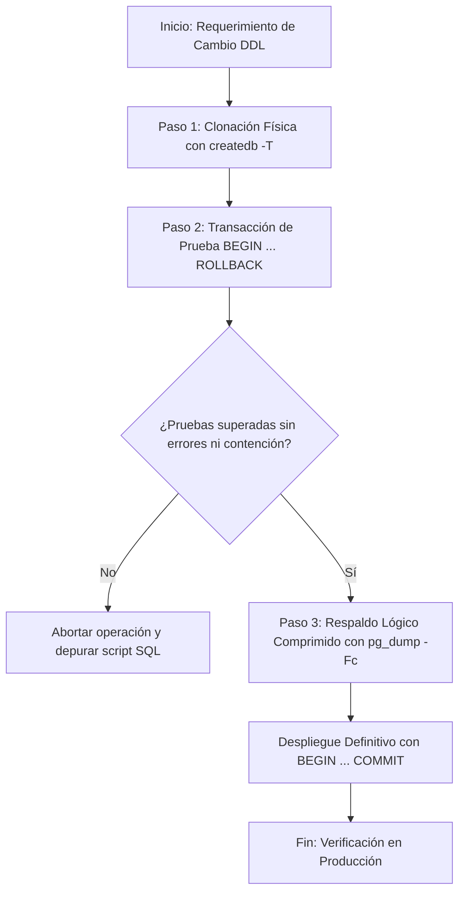

# Protocolo de Seguridad Operacional para Modificaciones DDL en PostgreSQL 16

**Cátedra:** Base de Datos II  
**Carrera:** Tecnicatura Universitaria en Programación a Distancia (UTN)  
**Proyecto:** Food Store  
**Entorno:** PostgreSQL 16 Local  
**Rol:** Administrador de Bases de Datos Senior (PostgreSQL DBA)

---

## 1. Fundamento Operacional y Política de Riesgo Cero

En entornos de producción, la ejecución de sentencias de Definición de Datos (DDL) como `ALTER TABLE`, `ADD CONSTRAINT` o `CREATE TRIGGER` representa una operación crítica. Estas sentencias adquieren bloqueos exclusivos sobre las tablas afectadas (`AccessExclusiveLock`). Este tipo de bloqueo detiene cualquier lectura (`SELECT`) o escritura (`INSERT`, `UPDATE`, `DELETE`) concurrente. 

Un error de sintaxis, una violación de integridad oculta en registros preexistentes o un bloqueo prolongado pueden inducir denegación de servicio (DoS) e inconsistencias graves. Para mitigar estos riesgos, se establece un protocolo estricto y secuencial de tres pasos antes de aplicar cualquier cambio estructural en el catálogo de PostgreSQL 16.



---

## 2. Paso 1: Clonación Acelerada de Base de Datos con `createdb -T`

### 2.1 Justificación Técnica
PostgreSQL permite utilizar cualquier base de datos existente como plantilla (*template*) durante la creación de una nueva base de datos mediante el parámetro `-T` (o la cláusula SQL `TEMPLATE`).

A nivel de motor y sistema de archivos, esta operación no procesa sentencias SQL tupla por tupla. El proceso de fondo realiza una copia física a nivel de bloques de los archivos correspondientes a las tablas e índices ubicados en el subdirectorio de datos del cluster (`$PGDATA/base/<db_oid>`). 

En sistemas de archivos modernos con soporte para *Copy-on-Write* (CoW) como Btrfs, ZFS o XFS con reflink en Linux, la clonación es casi instantánea. Los bloques de almacenamiento compartidos se duplican únicamente cuando se escribe una modificación física sobre ellos. Esto minimiza el consumo de disco y reduce a segundos la preparación de un entorno idéntico para auditoría previa.

### 2.2 Requisito Crítico: Desconexión de Conexiones Activas
PostgreSQL prohíbe clonar una base de datos que reciba conexiones concurrentes durante el copiado físico. Para habilitar la clonación, el DBA debe terminar las sesiones abiertas.

### 2.3 Comandos Operacionales de Bash y psql

```bash
# 1. Terminar conexiones activas hacia la base de datos origen
psql -U postgres -d postgres -c "
SELECT pg_terminate_backend(pid) 
FROM pg_stat_activity 
WHERE datname = 'food_store' 
  AND pid <> pg_backend_pid();
"

# 2. Ejecutar la clonación física Copy-on-Write
createdb -U postgres -h localhost -p 5432 -T food_store food_store_pre_ddl

# 3. Comprobar la existencia del clon en el catálogo del cluster
psql -U postgres -d postgres -c "\l+ food_store_pre_ddl"
```

---

## 3. Paso 2: Transacción Interactiva de Prueba (`BEGIN ... ROLLBACK`)

### 3.1 Soporte de DDL Transaccional en PostgreSQL
A diferencia de otros motores relacionales como Oracle o MySQL donde las sentencias DDL ejecutan un commit implícito e irreversible, PostgreSQL implementa **Transactional DDL**. 

En PostgreSQL, prácticamente todas las modificaciones estructurales (`CREATE TABLE`, `ALTER TABLE`, `DROP CONSTRAINT`, `CREATE TRIGGER`, `CREATE FUNCTION`) residen dentro del ámbito de una transacción ordinaria. Los cambios sobre las tablas del catálogo del sistema (`pg_class`, `pg_attribute`, `pg_constraint`, `pg_trigger`) son visibles para la sesión actual y permanecen aislados de las demás conexiones hasta la confirmación.

### 3.2 Protocolo de Prueba sin Persistencia
Antes de aplicar las modificaciones de forma definitiva, el script DDL debe ejecutarse íntegramente dentro de un bloque interactivo cerrado por un `ROLLBACK`. Esto permite verificar:
1. Validez de sintaxis en PostgreSQL 16.
2. Incompatibilidad de tipos de datos o funciones no deterministas.
3. Existencia de registros históricos que violen las nuevas restricciones declarativas.
4. Correcto disparo y lógica de funciones PL/pgSQL y triggers.

### 3.3 Script de Validación Transaccional en psql

```sql
-- Conectarse a la base de datos de pruebas o desarrollo
\c food_store_pre_ddl

-- Iniciar transacción aislada
BEGIN;

-- Ajustar temporizador de bloqueo defensivo a 3 segundos
SET LOCAL lock_timeout = '3s';

-- Ejecutar el script de restricciones
\ir sql/restricciones.sql

-- Inspeccionar el catálogo de restricciones creadas
SELECT 
    conrelid::regclass AS tabla,
    conname AS nombre_restriccion,
    contype AS tipo,
    pg_get_constraintdef(oid) AS definicion
FROM pg_constraint
WHERE conrelid IN ('pedido'::regclass, 'detalle_pedido'::regclass)
ORDER BY conrelid, conname;

-- Inspeccionar los triggers registrados en el catálogo
SELECT 
    tgname AS nombre_trigger,
    relname AS tabla,
    tgenabled AS habilitado,
    proname AS funcion_ejecutada
FROM pg_trigger trg
JOIN pg_class cls ON trg.tgrelid = cls.oid
JOIN pg_proc prc ON trg.tgfoid = prc.oid
WHERE cls.relname = 'pedido'
  AND NOT trg.tgisinternal;

-- Descartar absolutamente todas las modificaciones de la prueba
ROLLBACK;

-- Comprobar que el estado previo se mantiene intacto
\d pedido
```

---

## 4. Paso 3: Respaldo Lógico Comprimido con `pg_dump -Fc`

### 4.1 Justificación Técnica del Formato Custom (`-Fc`)
Nunca debe ejecutarse una migración definitiva de DDL sin un respaldo previo consistente. La utilidad oficial `pg_dump` ofrece múltiples formatos de exportación. 

El formato texto plano (`-Fp`) genera un script SQL directo. Este formato carece de metadatos de control, no permite reordenar sentencias si surgen dependencias cruzadas y exige un proceso de restauración estrictamente secuencial y mono-hilo.

El parámetro `-Fc` (Formato Custom) es el estándar recomendado para administración avanzada en PostgreSQL por las siguientes razones de arquitectura interna:
1. **Compresión binaria nativa:** Comprime los bloques de datos con algoritmos integrados (zlib/zstd), reduciendo drásticamente el espacio en disco y el cuello de botella de I/O.
2. **Tabla de Contenidos interna (TOC):** Incorpora una cabecera con el catálogo completo de objetos, tipos, tablas, índices y dependencias.
3. **Restauración selectiva flexible:** Mediante la herramienta `pg_restore`, el DBA puede listar el contenido del archivo con `pg_restore -l`, generar listas de exclusión o filtrar la restauración a esquemas, tablas específicas (`-t`) o definiciones DDL sin datos (`-s`).
4. **Restauración multiproceso paralela:** El formato custom permite utilizar el modificador `-j <workers>` en `pg_restore`. Esto distribuye la carga entre múltiples núcleos de CPU y conexiones concurrentes al recrear tablas e índices en paralelo.

### 4.2 Comandos de Ejecución y Verificación de Respaldo

```bash
# 1. Definir directorio seguro de copias de seguridad
BACKUP_DIR="/home/joaquin/Documentos/REPO_BD2_CHIARELLO/backups"
mkdir -p "$BACKUP_DIR"

# 2. Generar respaldo binario comprimido con marca temporal ISO
TIMESTAMP=$(date +"%Y%m%d_%H%M%S")
BACKUP_FILE="$BACKUP_DIR/food_store_pre_ddl_${TIMESTAMP}.dump"

pg_dump -h localhost -p 5432 -U postgres \
  -Fc -b -v \
  -f "$BACKUP_FILE" food_store

# 3. Comprobar la integridad física y leer la Tabla de Contenidos (TOC)
pg_restore -l "$BACKUP_FILE" | head -n 30
```

---

## 5. Protocolo de Ejecución Definitiva y Plan de Contingencia (Rollback)

### 5.1 Despliegue en Ventana de Mantenimiento
Una vez superados con éxito los pasos 1, 2 y 3, se aplica el script en la base productiva mediante una transacción explícita:

```bash
psql -U postgres -d food_store -v ON_ERROR_STOP=1 <<'EOF'
BEGIN;
SET LOCAL lock_timeout = '5s';
\ir sql/restricciones.sql
COMMIT;
EOF
```

El uso de `ON_ERROR_STOP=1` garantiza que si cualquier sentencia individual arroja un error, `psql` interrumpe de inmediato el procesamiento y cancela la transacción sin ejecutar el `COMMIT`.

### 5.2 Plan de Contingencia ante Fallas Inesperadas
Si tras el commit se detecta una degradación de rendimiento no tolerable o una incompatibilidad de la aplicación cliente:

1. **Restauración de Esquema desde el Clon del Paso 1:**
   ```bash
   psql -U postgres -d postgres -c "
   SELECT pg_terminate_backend(pid) FROM pg_stat_activity WHERE datname = 'food_store';
   ALTER DATABASE food_store RENAME TO food_store_degradada;
   ALTER DATABASE food_store_pre_ddl RENAME TO food_store;
   "
   ```

2. **Restauración Integral desde Respaldo Custom del Paso 3:**
   ```bash
   dropdb -U postgres -h localhost food_store
   createdb -U postgres -h localhost food_store
   pg_restore -U postgres -h localhost -p 5432 -d food_store -j 4 -v "$BACKUP_FILE"
   ```
